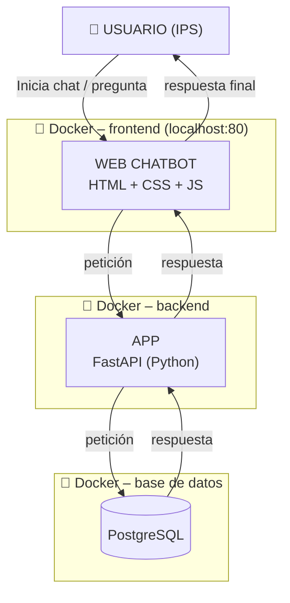

# PROMPT MAESTRO — MVP CHATBOT PARA IPS

## 1. CONTEXTO DEL PROYECTO

Soy estudiante de **Administración en Salud** y estoy desarrollando un proyecto académico para la universidad.

Necesito crear un **MVP (Minimum Viable Product) de un chatbot para una IPS / centro de salud**, enfocado inicialmente en la gestión administrativa y el control de medicamentos.

### IMPORTANTE SOBRE MI PERFIL

No soy desarrolladora de software ni especialista en programación.

Por esta razón:

- **No me hagas preguntas técnicas innecesarias.**
- No me preguntes qué lenguaje, framework, base de datos, estructura de carpetas o arquitectura quiero utilizar si puedes tomar una decisión razonable por tu cuenta.
- **Toma tú las decisiones técnicas necesarias** buscando siempre la alternativa más sencilla, gratuita, estable y fácil de ejecutar.
- Si existen varias alternativas técnicas, elige la más adecuada para un MVP académico y continúa.
- Explícame de manera sencilla qué estás haciendo y por qué.
- No compliques el proyecto con tecnologías innecesarias.
- Prioriza que el proyecto sea funcional, fácil de ejecutar, fácil de demostrar y fácil de explicar ante un profesor.

Mi objetivo principal es tener un **MVP funcional y presentable**, no construir todavía un sistema hospitalario de producción.

---

# 2. OBJETIVO DEL MVP

Construir un chatbot para una IPS que permita a diferentes usuarios consultar información relacionada principalmente con:

- Medicamentos.
- Inventario.
- Entradas y salidas.
- Fechas de vencimiento.
- Ubicación de medicamentos.
- Información general del sistema.
- Reportes básicos.

El chatbot deberá identificar el **rol del usuario** y permitir únicamente las funciones correspondientes a dicho rol.

El proyecto debe utilizar una **base de datos relacional** con datos ficticios.

NO utilizar datos reales de pacientes ni información clínica real.

---

# 3. ROLES DEL SISTEMA

El chatbot tendrá inicialmente tres roles.

## 3.1 Administrador del sistema

### Funciones principales

1. Crear y administrar usuarios.
2. Asignar permisos.
3. Consultar información general del sistema.

### Interacción con el chatbot

El administrador podrá utilizar el chat para consultar información y generar reportes.

Ejemplos:

> "Muéstrame los movimientos de medicamentos de esta semana."

> "¿Cuántos medicamentos tenemos registrados actualmente?"

> "¿Cuáles son los medicamentos que están por debajo del mínimo establecido?"

---

# 3.2 Responsable de farmacia / medicamentos

### Funciones principales

1. Consultar y actualizar el inventario.
2. Revisar fechas de vencimiento.
3. Controlar entradas y salidas de medicamentos.

### Interacción con el chatbot

Podrá realizar preguntas como:

> "¿Qué medicamentos están próximos a vencer?"

> "¿Cuánto inventario queda?"

> "¿Qué medicamentos tienen poco stock?"

> "¿Cuántas unidades de acetaminofén ingresaron este mes?"

---

# 3.3 Almacenista

### Funciones principales

1. Registrar entradas de medicamentos.
2. Registrar salidas de medicamentos.
3. Consultar existencias y ubicación.

### Interacción con el chatbot

Ejemplos:

> "¿Cuántas unidades de insulina quedan?"

> "¿Dónde está ubicada la insulina?"

> "¿Cuándo fue registrada la última entrada de acetaminofén?"

> "¿Qué medicamentos debo revisar por vencimiento?"

---

# 4. PREGUNTAS Y RESPUESTAS ESPERADAS

El chatbot deberá ser capaz de responder, utilizando la información almacenada en la base de datos, preguntas como las siguientes.

## ADMINISTRADOR

### Pregunta 1

> ¿Cuántos medicamentos tenemos registrados actualmente?

Respuesta esperada:

> "Actualmente hay [cantidad] medicamentos registrados en el sistema."

La cantidad debe obtenerse dinámicamente de la base de datos.

---

### Pregunta 2

> ¿Cuáles son los medicamentos que están por debajo del mínimo establecido?

Respuesta esperada:

> "Actualmente hay [cantidad] medicamentos con inventario bajo: [lista de medicamentos]."

La consulta debe comparar el inventario actual con el mínimo establecido para cada medicamento.

---

### Pregunta 3

> ¿Qué medicamentos están próximos a vencer durante los próximos 30 días?

Respuesta esperada:

> "Hay [cantidad] medicamentos próximos a vencer durante los próximos 30 días: [lista de medicamentos]."

La información debe calcularse utilizando la fecha actual y la fecha de vencimiento almacenada.

---

### Pregunta 4

> ¿Cuántas entradas y salidas de medicamentos se registraron durante este mes?

Respuesta esperada:

> "Durante este mes se registraron [cantidad] entradas y [cantidad] salidas de medicamentos."

---

### Pregunta 5

> ¿Qué medicamento tiene mayor movimiento durante este mes?

Respuesta esperada:

> "El medicamento con mayor movimiento durante este mes ha sido [nombre del medicamento], con [cantidad] movimientos registrados."

---

# 5. RESPONSABLE DE FARMACIA

### Pregunta 1

> ¿Cuántas unidades hay disponibles de [medicamento]?

Respuesta:

> "[Cantidad] unidades disponibles."

---

### Pregunta 2

> ¿Cuáles son los medicamentos que están por debajo del mínimo establecido?

Respuesta:

> "Hay [cantidad] medicamentos por debajo del mínimo establecido: [lista de medicamentos]."

---

### Pregunta 3

> ¿Qué medicamentos están próximos a vencer?

Respuesta:

> "Hay [cantidad] medicamentos próximos a vencer: [lista de medicamentos]."

---

### Pregunta 4

> ¿Cuántas unidades de [medicamento] ingresaron durante este mes?

Respuesta:

> "Durante este mes ingresaron [cantidad] unidades de [medicamento]."

---

### Pregunta 5

> ¿Cuántas unidades de [medicamento] salieron durante este mes?

Respuesta:

> "Durante este mes salieron [cantidad] unidades de [medicamento]."

---

# 6. ALMACENISTA

### Pregunta 1

> ¿Dónde está ubicado [medicamento]?

Respuesta:

> "[Ubicación del medicamento]."

---

### Pregunta 2

> ¿Cuántas unidades hay disponibles de [medicamento]?

Respuesta:

> "Actualmente hay [cantidad] unidades disponibles."

---

### Pregunta 3

> ¿Cuándo fue registrada la última entrada de [medicamento]?

Respuesta:

> "La última entrada fue registrada el [fecha], con [cantidad] unidades."

---

### Pregunta 4

> ¿Cuándo fue registrada la última salida de [medicamento]?

Respuesta:

> "La última salida fue registrada el [fecha], con [cantidad] unidades."

---

### Pregunta 5

> ¿Qué medicamentos debo revisar por vencimiento?

Respuesta:

> "Hay [cantidad] medicamentos que requieren revisión por vencimiento: [lista de medicamentos]."

---

# 7. ARQUITECTURA DE REFERENCIA

Esta es la arquitectura técnica de referencia que quiero utilizar para el proyecto:



Esta arquitectura es una **referencia**, no una restricción absoluta.

Si consideras que alguna decisión técnica debe modificarse para hacer el MVP más sencillo, gratuito y fácil de ejecutar, **toma tú la decisión**.

Mi prioridad es:

1. Que funcione.
2. Que sea gratuito.
3. Que sea sencillo.
4. Que pueda ejecutarse localmente.
5. Que sea fácil de presentar.
6. Que la arquitectura sea clara.
7. Que posteriormente pueda ampliarse.

---

# 8. TECNOLOGÍAS

Como referencia inicial, utiliza:

### Frontend

- HTML
- CSS
- JavaScript

Debe tener una interfaz moderna y sencilla de chatbot.

### Backend

- Python
- FastAPI

### Base de datos

- PostgreSQL

### Contenedores

- Docker
- Docker Compose

Sin embargo, si alguna de estas tecnologías genera una complejidad innecesaria para el MVP, puedes tomar una decisión técnica más sencilla.

No quiero pagar servicios externos.

Todo debe poder ejecutarse localmente.

---

# 9. DISEÑO VISUAL

El chatbot debe tener una **plantilla visual inspirada en una IPS / centro de salud**.

Quiero una interfaz profesional pero sencilla.

Debe transmitir visualmente:

- Salud.
- Confianza.
- Organización.
- Tecnología.
- Administración de servicios de salud.

La interfaz debe tener como mínimo:

### Encabezado

Nombre de la IPS.

Ejemplo:

**IPS Centro de Salud**

Subtítulo:

**Asistente Virtual**

### Menú lateral

Debe mostrar:

- Inicio
- Chat
- Medicamentos
- Inventario
- Movimientos
- Vencimientos
- Usuarios

Las opciones deberán adaptarse según el rol.

### Área principal

Una interfaz de conversación:

```text
┌──────────────────────────────────────────┐
│ 🏥 IPS CENTRO DE SALUD                   │
│    Asistente Virtual                     │
├───────────────┬──────────────────────────┤
│               │                          │
│ Inicio        │  🤖 Asistente IPS        │
│ Chat          │                          │
│ Medicamentos  │  Hola, ¿en qué puedo     │
│ Inventario    │  ayudarte?               │
│ Movimientos   │                          │
│ Vencimientos  │  👤 ¿Cuántos medicamentos│
│               │  tenemos registrados?    │
│               │                          │
│               │  🤖 Actualmente hay 25   │
│               │  medicamentos registrados│
│               │                          │
│               │ [Escribe tu pregunta...] │
└───────────────┴──────────────────────────┘
```

El diseño debe ser **responsive**, para que pueda visualizarse correctamente en computador.

---

# 10. BASE DE DATOS

Crear una base de datos relacional con información ficticia.

Como mínimo debe existir información relacionada con:

### Usuarios

- id
- nombre
- usuario
- contraseña o mecanismo seguro de autenticación
- rol
- estado

### Roles

- id
- nombre

### Medicamentos

- id
- nombre
- principio activo
- presentación
- cantidad actual
- stock mínimo
- fecha de vencimiento
- ubicación
- estado

### Movimientos

- id
- medicamento
- tipo de movimiento
- cantidad
- fecha
- usuario responsable

Los movimientos deben permitir identificar:

- Entradas.
- Salidas.

Si consideras necesarias otras tablas para mantener correctamente la relación entre los datos, créalas.

La base de datos debe estar correctamente normalizada para el alcance del MVP.

---

# 11. DATOS DE PRUEBA

Crear datos ficticios suficientes para demostrar el funcionamiento del chatbot.

Por ejemplo:

- Al menos 3 usuarios.
- Los tres roles.
- Al menos 10 medicamentos.
- Diferentes niveles de inventario.
- Algunos medicamentos por debajo del mínimo.
- Algunos medicamentos próximos a vencer.
- Diferentes entradas.
- Diferentes salidas.
- Diferentes ubicaciones.

Los datos deben permitir comprobar todas las preguntas planteadas anteriormente.

NO utilizar información personal real.

---

# 12. FUNCIONAMIENTO DEL CHATBOT

El chatbot debe interpretar preguntas escritas de manera natural.

Por ejemplo, estas preguntas deberían llevar a la misma consulta:

> ¿Cuánto acetaminofén queda?

> ¿Cuántas unidades de acetaminofén hay?

> ¿Qué cantidad de acetaminofén tenemos?

El sistema debería identificar que todas corresponden a:

**CONSULTAR_INVENTARIO_MEDICAMENTO**

Inicialmente no es obligatorio utilizar una API de inteligencia artificial de pago.

Puedes implementar un sistema sencillo de reconocimiento de intenciones y reglas.

Si consideras que posteriormente se puede incorporar un modelo de IA gratuito o local, deja la arquitectura preparada para ello, pero **no compliques el MVP inicial**.

---

# 13. SEGURIDAD Y PERMISOS

El sistema debe respetar los roles.

Por ejemplo:

### Administrador

Puede consultar información general y reportes.

### Responsable de farmacia

Puede consultar información de inventario, vencimientos y movimientos.

### Almacenista

Puede consultar existencias, ubicaciones y movimientos relacionados con almacén.

No permitir que un usuario pueda consultar funciones que no corresponden a su rol.

Utilizar datos completamente ficticios.

No incluir historias clínicas reales ni datos clínicos reales.

---

# 14. API

Crear endpoints sencillos para las principales operaciones.

Por ejemplo:

```text
GET /medicamentos
GET /medicamentos/{id}
GET /medicamentos/bajo-stock
GET /medicamentos/proximos-vencer
GET /medicamentos/{id}/inventario

GET /movimientos
GET /movimientos/entradas
GET /movimientos/salidas

GET /usuarios
GET /servicios
```

También crear el endpoint del chatbot:

```text
POST /chat
```

Ejemplo:

```json
{
    "mensaje": "¿Cuántos medicamentos están por debajo del mínimo?"
}
```

Respuesta:

```json
{
    "respuesta": "Actualmente hay 3 medicamentos por debajo del mínimo establecido: Acetaminofén, Amoxicilina y Losartán."
}
```

---

# 15. REGLAS IMPORTANTES DE DESARROLLO

Quiero que trabajes como un **desarrollador senior responsable del proyecto**, mientras yo me encargo principalmente de la parte de Administración en Salud.

Por lo tanto:

- Toma las decisiones técnicas.
- No me hagas preguntas técnicas si puedes resolverlas tú.
- Evita sobreingeniería.
- No agregues tecnologías innecesarias.
- No agregues servicios pagos.
- Mantén el código organizado.
- Utiliza nombres claros.
- Comenta únicamente lo necesario.
- Mantén una estructura fácil de entender.
- Utiliza buenas prácticas básicas.
- Valida los datos de entrada.
- Utiliza consultas seguras a la base de datos.
- No expongas credenciales.
- Utiliza variables de entorno cuando corresponda.
- No utilices datos reales de pacientes.

---

# 16. DOCKER

Si utilizas Docker, crea:

### Contenedor frontend

Para servir la aplicación web.

### Contenedor backend

Para FastAPI.

### Contenedor PostgreSQL

Para la base de datos.

Utiliza Docker Compose para levantar todo el proyecto.

El objetivo final debería ser poder ejecutar algo similar a:

```bash
docker compose up --build
```

Y tener el MVP funcionando localmente.

Si necesitas modificar esta estrategia para evitar complejidad innecesaria, toma tú la decisión.

---

# 17. EXPERIENCIA DEL USUARIO

Cuando el usuario ingrese al sistema:

1. Debe poder iniciar sesión.
2. El sistema identifica su rol.
3. Se muestra la interfaz correspondiente.
4. Puede acceder al chatbot.
5. Escribe una pregunta.
6. El chatbot identifica la intención.
7. El backend realiza la consulta correspondiente.
8. La base de datos devuelve la información.
9. El chatbot presenta una respuesta clara y amigable.

Ejemplo:

```text
👤 Usuario:
¿Cuáles son los medicamentos que están por debajo del mínimo?

🤖 Asistente IPS:

Actualmente hay 3 medicamentos por debajo
del mínimo establecido:

• Acetaminofén — 15 unidades
• Amoxicilina — 8 unidades
• Losartán — 12 unidades

Te recomiendo revisar estos medicamentos
en el inventario.
```

---

# 18. MANEJO DE PREGUNTAS NO RECONOCIDAS

Si el chatbot no entiende una pregunta, no debe inventar información.

Debe responder algo como:

> "No pude identificar tu consulta. Puedes preguntarme sobre inventario, medicamentos, movimientos, vencimientos o ubicaciones."

---

# 19. DOCUMENTACIÓN

Crear un README.md que explique:

1. Nombre del proyecto.
2. Objetivo.
3. Arquitectura.
4. Tecnologías utilizadas.
5. Estructura del proyecto.
6. Cómo instalarlo.
7. Cómo ejecutarlo.
8. Usuarios de prueba.
9. Ejemplos de preguntas.
10. Ejemplos de respuestas.
11. Cómo funciona la conexión con la base de datos.
12. Cómo funciona el sistema de roles.

La documentación debe estar escrita en un lenguaje sencillo, adecuado para un proyecto universitario.

---

# 20. FORMA DE TRABAJO

Quiero que desarrolles el proyecto por etapas.

### ETAPA 1 — Estructura

Crear la estructura inicial del proyecto.

### ETAPA 2 — Base de datos

Crear PostgreSQL, tablas, relaciones y datos ficticios.

### ETAPA 3 — Backend

Crear FastAPI y los endpoints.

### ETAPA 4 — Sistema de usuarios y roles

Implementar autenticación y permisos básicos.

### ETAPA 5 — Chatbot

Implementar reconocimiento de las principales intenciones.

### ETAPA 6 — Frontend

Crear la interfaz visual de la IPS.

### ETAPA 7 — Integración

Conectar:

```text
Frontend
   ↓
Chatbot
   ↓
FastAPI
   ↓
PostgreSQL
```

### ETAPA 8 — Pruebas

Probar todas las preguntas y respuestas definidas anteriormente.

### ETAPA 9 — Documentación

Completar el README y explicar cómo ejecutar el proyecto.

---

# 21. CRITERIO PRINCIPAL

Recuerda que esto es un **MVP académico**, no un sistema real de una IPS.

No necesito:

- Microservicios.
- Kubernetes.
- Cloud.
- Sistemas distribuidos.
- Arquitecturas complejas.
- Servicios de pago.
- IA avanzada obligatoriamente.
- Integraciones con sistemas reales de salud.

Necesito demostrar claramente:

**USUARIO → CHATBOT → BACKEND → BASE DE DATOS RELACIONAL → RESPUESTA**

El resultado debe ser suficientemente funcional para hacer una demostración ante el profesor.

---

# 22. PRIMER PASO

Comienza analizando este requerimiento y toma las decisiones técnicas necesarias.

**No me hagas preguntas técnicas.**

Primero:

1. Propón brevemente la arquitectura final que utilizarás.
2. Explica las decisiones técnicas en lenguaje sencillo.
3. Crea la estructura inicial del proyecto.
4. Después comienza la implementación.

Si encuentras una decisión que pueda afectar significativamente el alcance o el funcionamiento del proyecto, toma la alternativa más sencilla y continúa.

Quiero que priorices siempre:

**Simplicidad + funcionamiento + costo $0 + facilidad de demostración + posibilidad de crecimiento.**
